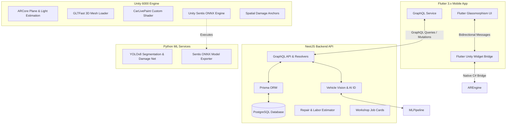

# 🚗 AR Car Customizer & Smart Workshop Assistant

[](https://flutter.dev)
[](https://unity.com)
[](https://developers.google.com/ar)
[](https://nestjs.com)
[](https://graphql.org)
[](https://prisma.io)
[](https://github.com/ultralytics/ultralytics)
[](https://unity.com/products/sentis)

An end-to-end Augmented Reality vehicle customization, real-time paint visualization, AI-driven vehicle damage inspection, and workshop management platform.

Combines high-fidelity AR rendering in **Unity**, a sleek **Flutter** mobile experience, on-device neural network segmentation with **Unity Sentis** & **YOLOv8**, and an enterprise **NestJS GraphQL** backend.

---

## 🌟 Key Highlights

### 🎨 1. Real-Time AR Vehicle Customizer
- **Interactive Paint Studio**: Seamlessly switch between finishes (**Gloss, Matte, Satin, Metallic, and Candy**) with full RGB/HEX color tuning.
- **Panel-Specific Customization**: Paint individual body panels independently (Hood, Roof, Doors, or Full Body).
- **Dynamic 3D Part Swapping**: Live glTF asset streaming using GLTFast to equip custom rims, spoilers, and accessories (`rim.glb`, `spoiler.glb`).
- **ARCore Environmental Lighting**: Real-time room light estimation and horizontal ground plane anchoring for realistic shadows and car positioning.
- **High-Res Snapshot & Share**: Capture AR photos directly to the native share sheet and export shareable garage configuration codes.

### 🧠 2. On-Device AI Segmentation & Live Paint Filter
- **Live Camera Car Isolation**: Real-time camera shader overlay (`CarLivePaint.shader`) that isolates and tints vehicle surfaces directly through the camera feed.
- **Unity Sentis Integration**: Direct on-device neural inference using an optimized ONNX model (`CarSegMask.onnx`), avoiding cloud latency for real-time video tinting.
- **YOLOv8 Vision Pipeline**: Python ML pipeline (`ml/segment_car.py`, `ml/export_sentis_mask.py`) for vehicle instance segmentation, wheel/glass filtering, and mask export.

### 🛠️ 3. Spatial AR Damage Inspection & Workshop Assistant
- **Automated Damage Assessment**: YOLOv8 computer vision detector (`ml/damage_detector.py`) identifying dents, scratches, cracks, tears, and paint damage with panel localization and area percentage calculation.
- **Spatial 3D AR Anchors**: Pins interactive 3D damage markers directly onto the physical vehicle body in AR space (`SpatialDamageAnchorManager.cs`).
- **Hands-Free Voice Commands**: Integrated voice command dispatcher (`VoiceCommandDispatcher.cs`) for mechanics and technicians in workshop environments.
- **Digital Job Cards & Cost Estimator**: Automated labor hour calculation, part replacement recommendations, and quote generation through GraphQL.

---

## 🏗️ System Architecture



---

## 📁 Repository Structure

```
ar-car-customizer/
├── client/                     # Flutter mobile application
│   ├── lib/
│   │   ├── main.dart           # App entry point & theme
│   │   ├── models/             # Inspection, Car, Paint models
│   │   ├── screens/            # Customization, Workshop, Garage, Brand screens
│   │   ├── services/           # GraphQL service & Unity communication bridge
│   │   └── widgets/            # Reusable UI controls and color pickers
│   └── android/                # Android runner & native integration
├── My project/                 # Unity AR project (Unity 6000.x)
│   ├── Assets/
│   │   ├── Resources/          # CarSegMask.onnx Sentis neural model
│   │   ├── Scripts/            # Unity AR controllers, Sentis, Anchors, Shaders
│   │   └── Shaders/            # CarLivePaint.shader real-time overlay
│   └── ProjectSettings/        # ARCore, Sentis, and Build configurations
├── backend/                    # NestJS GraphQL Backend
│   ├── prisma/                 # Database schema & seed data
│   ├── public/                 # glTF 3D models (truck, rims, spoilers) & damage photos
│   └── src/
│       ├── auth/               # JWT authentication & user accounts
│       ├── car/                # Car models, colors, parts catalog
│       ├── estimator/          # Damage labor & parts cost estimation
│       ├── inspection/         # Vehicle damage inspection records
│       ├── jobcard/            # Workshop job card workflow
│       └── vision/             # Vehicle identification & live segmentation
├── ml/                         # Machine Learning Pipeline
│   ├── damage_detector.py      # Damage detection, panel mapping & severity scoring
│   ├── export_sentis_mask.py   # Exports YOLOv8 mask network to Unity Sentis ONNX
│   ├── segment_car.py          # Standalone & YOLOv8 vehicle mask extraction
│   └── live_segment_worker.py  # Real-time segmentation background worker
└── run-on-phone.bat            # Automated one-click Android deployment script
```

---

## 🚀 Getting Started

### Prerequisites
- **Flutter SDK**: 3.19+
- **Node.js**: 18+ & **Docker** (for PostgreSQL)
- **Unity**: 6000.x (with Android Build Support & ARCore)
- **Python**: 3.10+ (for ML scripts)
- **Android Device**: ARCore-supported smartphone (with USB debugging enabled)

---

### 1. Backend Setup

```bash
cd backend

# 1. Start PostgreSQL via Docker Compose
docker compose up -d

# 2. Configure environment variables
cp .env.example .env

# 3. Install dependencies & initialize database
npm install
npx prisma db push
npx prisma db seed

# 4. Start NestJS dev server
npm run start:dev
```
The GraphQL Playground is available at `http://localhost:3000/graphql`.

**Demo Credentials**:
- **Email**: `demo@arcar.com`
- **Password**: `demo-password`

---

### 2. ML & On-Device Model Setup (Optional)

To test the vehicle damage detector or export an updated Sentis mask:

```bash
cd ml
pip install -r requirements.txt

# Run synthetic damage detection self-test:
python damage_detector.py --self-test

# Export optimized Sentis ONNX model to Unity:
python export_sentis_mask.py --output "../My project/Assets/Resources/CarSegMask.onnx"
```

---

### 3. Unity AR Export

1. Open `My project/` in **Unity Hub** (Unity 6000.x).
2. Ensure **Android** is the active build target in *Build Settings*.
3. Run the export script or build the Unity player library into `client/android/unityLibrary/`.

---

### 4. Running the Flutter App on Mobile

From the project root:

```bat
run-on-phone.bat
```

> **Note**: Update the LAN IP in `run-on-phone.bat` if your computer's IP address changes. Both the smartphone and computer must be connected to the same Wi-Fi network.

---

## 🛰️ GraphQL API Highlights

| Operation | Type | Description |
|---|---|---|
| `login` | Mutation | Authenticates user and returns JWT token |
| `brands` / `cars` | Query | Retrieves car catalog, available colors, and compatible parts |
| `saveCarConfiguration` | Mutation | Saves customized car configuration to the user's garage |
| `recordDamageAssessment`| Mutation | Logs inspection damage points, severity, and panel localization |
| `generateJobCard` | Mutation | Creates a workshop repair job card with cost estimates |
| `identifyVehicle` | Query | Performs computer vision car identification from camera photo |

---

## 🛡️ License

This project is licensed under the MIT License. See [LICENSE](LICENSE) for details.
Stand-in 3D model assets are credited in `backend/public/models/ATTRIBUTION.txt`.
